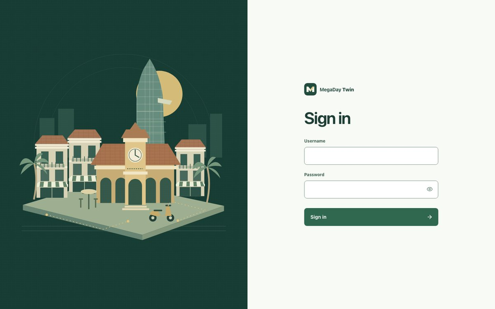
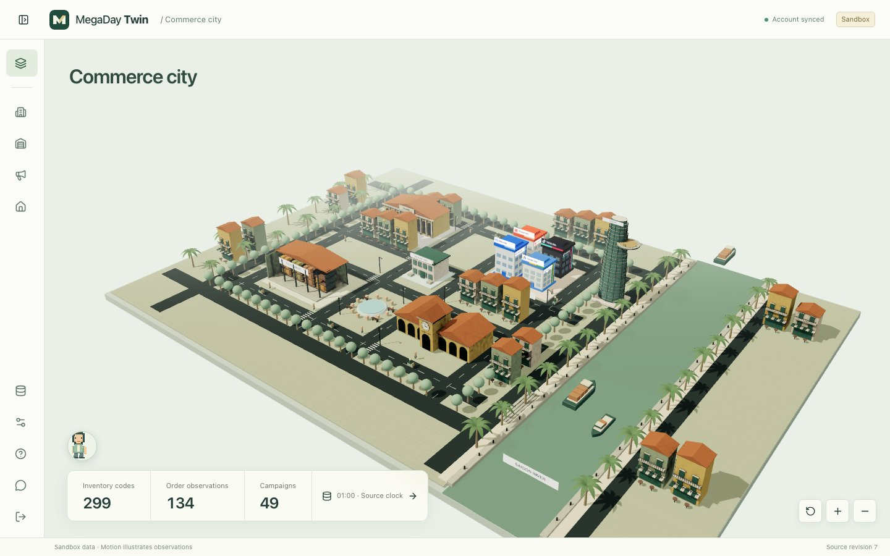
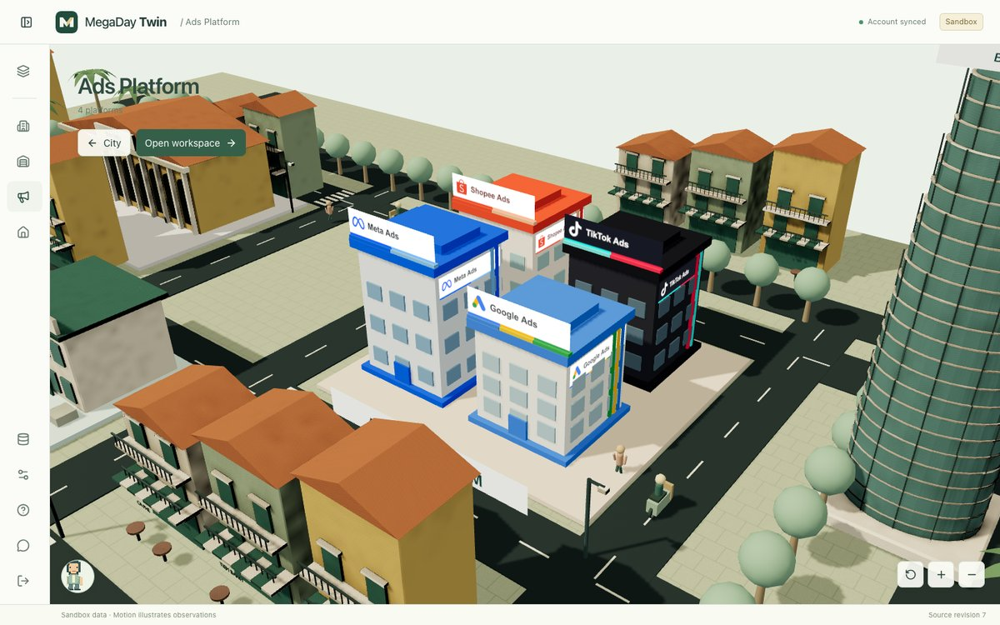
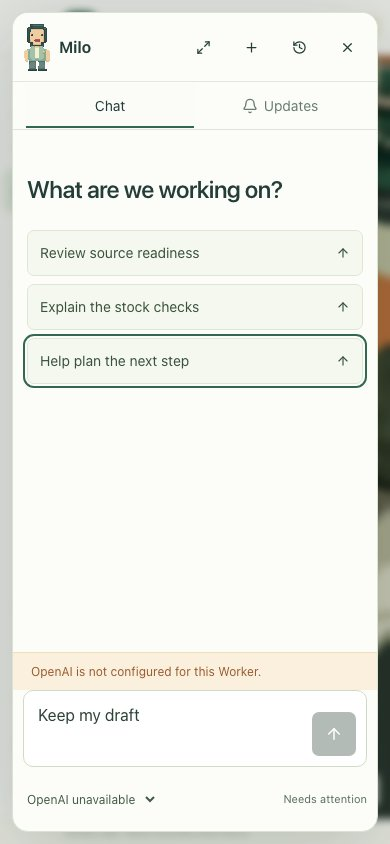
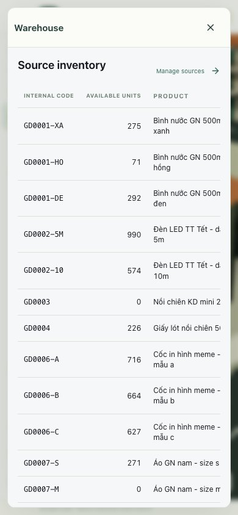

# Saigon city validation

Validated locally against the Cloudflare production build, including its content policy. The existing Vite development preamble is blocked by that policy, so browser QA uses a local Wrangler preview of the built Worker. No production secrets or production data were used.

## Checks

- `NODE_OPTIONS=--no-experimental-webstorage node scripts/check.mjs web`: deployment regression tests, lint, 220 Vitest tests, typechecked Cloudflare build, deployment dry run.
- `node web/qa/saigon.mjs`: 1440×900, 1024×768, 768×1024, 390×844, and 844×390; bounded panels, keyboard containment on mobile, retained drafts, login layout, six-step tutorial, quiet two-tab updates, source-row navigation, and persistence across city/Data Studio navigation.
- Supplemental checks: all four ad brands, three city/Data Studio navigation cycles with one canvas remaining, failed-GLB fallback, and district navigation with WebGL disabled.
- Reduced motion: two scene screenshots taken apart have identical hashes.
- No console errors in the production-preview browser checks. Live model replies are covered by mocked request/storage integration tests; no paid OpenAI call was made in this QA run.
- glTF validation: no errors or warnings. The validator reports that it cannot inspect `EXT_meshopt_compression`; actual decoding and rendering were verified in Chrome.

## Render measurements

| Profile | Result |
| --- | --- |
| Expanded architecture GLB | 626,092 bytes, shared 2048px AO atlas, Meshopt + WebP |
| All Milo PNGs | About 34 KB |
| Default desktop scene | 97 draw calls, 162,650 rendered triangles |
| All four ad platforms, overview | 130 draw calls, 164,646 rendered triangles |
| Chrome, Apple M3 Pro, 1440×900 | 120 FPS; 9.3 ms p95 frame interval |
| Chrome, 390×844 @2×, CPU slowed 4× | 120 FPS; 10 ms p95 frame interval |
| Headless software rendering | About 10 FPS; functional checks pass |

CPU throttling retains the host GPU. This is not a measurement on a physical low-end phone. The app retains district navigation when WebGL is unavailable and a low-detail scene while architecture loads. Asset download and geometry counts meet the planned budgets; performance on other hardware still varies.

## Review images

## Reproduce

Build with `npm --prefix web run build:cloudflare`. Run the generated Worker/assets locally with the account Durable Object and D1 bindings, using local-only auth credentials. Then run `QA_BASE_URL=http://127.0.0.1:5179 QA_PASSWORD_FILE=/private/path/to/local-password node web/qa/saigon.mjs`. The script rejects non-local hosts, temporarily replaces only the local inventory fixture, restores it, and writes results/screenshots under ignored `qa/runs/saigon-city-milo/`.

The default GitHub workflow is manual, as configured on main. These are local results, not a claim that hosted CI ran or that production was deployed.
