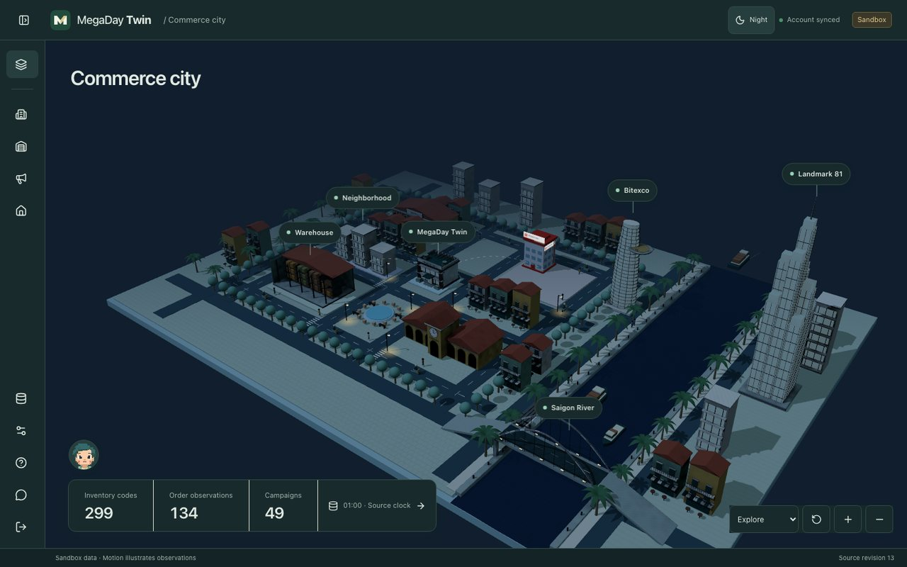
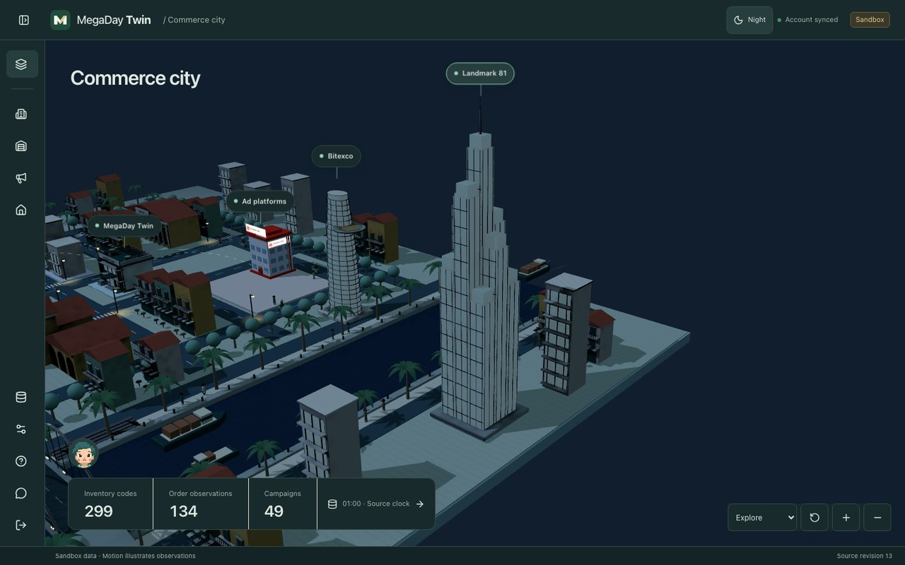
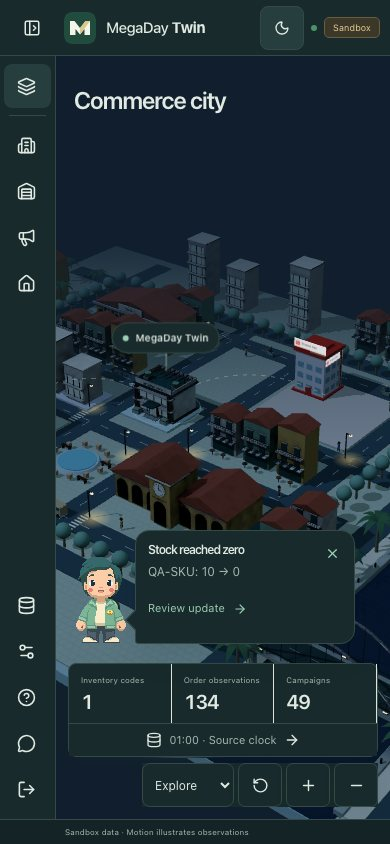

# Saigon city validation

Validated locally against the Cloudflare production build, including its content policy. The existing Vite development preamble is blocked by that policy, so browser QA uses a local Wrangler preview of the built Worker. No production secrets or production data were used.

## Checks

- `NODE_OPTIONS=--no-experimental-webstorage node scripts/check.mjs web`: deployment regression tests, lint, 238 Vitest tests, typechecked Cloudflare build, deployment dry run.
- `node web/qa/saigon.mjs`: 1440×900, 1024×768, 768×1024, 390×844, and 844×390; bounded panels, keyboard containment on mobile, retained drafts, login layout, seven-step tutorial with river/lighting actions, quiet two-tab Milo speech bubbles, source-row navigation, and persistence across city/Data Studio navigation.
- Supplemental checks: all four ad brands, three city/Data Studio navigation cycles with one canvas remaining, failed-GLB fallback, and district navigation with WebGL disabled.
- Morning/Night survives reload, themes portaled panels, leaves the source clock unchanged and reuses the canvas. Reduced motion: scene screenshots taken apart have identical hashes in both modes.
- Floating map labels navigate to HQ and Landmark 81; the Explore menu retains landmark access on narrow screens.
- No console errors in the production-preview browser checks. The final mobile selected-label adjustment was additionally verified with a focused narrow-screen landmark check. Live model replies are covered by mocked request/storage integration tests; no paid OpenAI call was made in this QA run.
- glTF validation: no errors or warnings. The validator reports that it cannot inspect `EXT_meshopt_compression`; actual decoding and rendering were verified in Chrome.

## Main-branch integration

The ZIP import and warehouse demand-label workflow from `f34ba26` is preserved. Regression tests cover Milo source selection after search/pagination and independent monitoring/server resolution of general tables by filename. Warehouse assessment and evidence controls use the city appearance tokens. The complete city browser suite passed again after the merge resolution, including night-mode controls at five viewports; the separate ZIP import → persisted tables → warehouse/model UI contract suite passed at four widths. Chrome DevTools inspection found no console errors or warnings.

## Render measurements

| Profile | Result |
| --- | --- |
| Expanded architecture GLB | 698,140 bytes, shared 2048px AO atlas, Meshopt + WebP |
| All Milo PNGs | 24,103 bytes |
| Default desktop scene | 124 draw calls, about 187k rendered triangles |
| All four ad platforms, overview | 157 draw calls, 188,604 rendered triangles |
| Chrome, Apple M3 Pro, 1440×900 | 120 FPS; 9.4 ms p95 frame interval |
| Chrome, 390×844 @2×, CPU slowed 4× | 120 FPS; 9.8 ms p95 frame interval |
| Headless software rendering | 9 FPS, 150 ms p95; functional checks pass |

CPU throttling retains the host GPU. This is not a measurement on a physical low-end phone. The app retains district navigation when WebGL is unavailable and a low-detail scene while architecture loads. Asset download and geometry counts meet the planned budgets; performance on other hardware still varies.

## Review images

## Reproduce

Build with `npm --prefix web run build:cloudflare`. Run the generated Worker/assets locally with the account Durable Object and D1 bindings, using local-only auth credentials. Then run `QA_BASE_URL=http://127.0.0.1:5179 QA_PASSWORD_FILE=/private/path/to/local-password node web/qa/saigon.mjs`. The script rejects non-local hosts, temporarily replaces only the local inventory fixture, restores it, and writes results/screenshots under ignored `qa/runs/saigon-city-milo/`.

The default GitHub workflow is manual, as configured on main. These are local results, not a claim that hosted CI ran or that production was deployed.

## City life and resizable workspaces (2026-10-31)

- 249 tests across 34 files, deployment safeguards, lint, typechecked Cloudflare build and deployment dry run passed.
- `QA_HEADED=1 node web/qa/workspaces.mjs` passed in WebKit and Chromium: automatic HQ/Ads/Warehouse panels, three-place tutorial, 980px desktop default, pointer/keyboard resizing, expand/restore, direct Milo Chat with retained drafts, and mobile tutorial/chat layout.
- `QA_HEADED=1 node web/qa/saigon.mjs` passed at five viewports, including quiet two-tab notifications, source navigation, no automatic AI calls, and static reduced-motion screenshots in both appearances. The local inventory fixture was restored.
- Overview: 143 draw calls, 205,504 rendered triangles, 120 FPS and 9.6 ms p95 frame interval on this Mac. Close HQ view in Chrome DevTools: 130 draw calls, approximately 214k triangles, 120 FPS. These are desktop hardware measurements, not low-end mobile guarantees.
- `QA_HEADED=1 node web/qa/city-layout.mjs` passed Chromium and WebKit at five viewports: viewport containment, Ben Thanh navigation, wheel interactions, Milo, Warehouse and navigation/reload. Final Chrome DevTools console has no warnings or errors. All four ad platforms: 177 draw calls, 207,508 triangles.
- Original procedural architecture/clothing/tire/paint detail retains the Blender AO UVs. Citizens and vehicles remain instanced. No downloaded assets, new dependencies, migrations or production secrets are included.

Browser scripts accept `QA_HEADED=1` for a hardware-rendered local run. Screenshots/results remain under ignored `qa/runs/`; the earlier screenshots above document the previous release.
